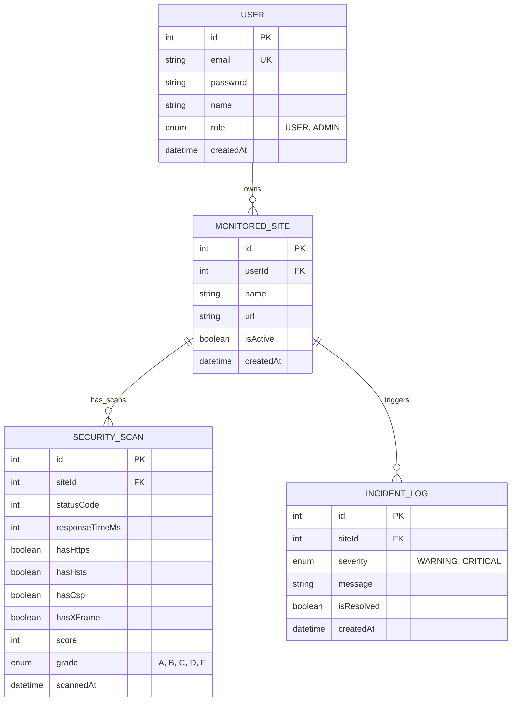

# SecAudit – Weboldal Biztonsági és Uptime Monitoring Portál

Konténerizált full-stack webalkalmazás weboldalak elérhetőségének, válaszidejének és HTTP biztonsági fejléceinek (HTTPS, HSTS, CSP, X-Frame-Options) ellenőrzésére és A–F osztályozására.

## Technológiai stack
- **Frontend:** React 18 (Vite), Bootstrap 5, Axios
- **Backend:** Node.js 20, Express.js, Prisma ORM, JWT, Jest, Swagger UI
- **Adatbázis:** MySQL 8.0
- **Infrastruktúra:** Docker & Docker Compose

## Adatbázis modell (ER-Diagram)

## Gyors indítás (Docker)
1. Másold le a konfigurációs fájlt: `cp .env.example .env`
2. Indítsd el a konténereket: `docker compose up --build`
3. Elérés:
   - Frontend: `http://localhost:3000`
   - Backend API: `http://localhost:5000`
   - Swagger dokumentáció: `http://localhost:5000/api-docs`

## Éles környezet (Oracle Cloud VPS)

- **Webalkalmazás (Frontend):** http://92.5.47.41:3000
- **API dokumentáció (Swagger UI):** http://92.5.47.41:5000/api-docs

### Demó hozzáférések (seedelt fiókok)
- **Admin:** `admin@secaudit.hu` / `Admin123!`
- **Felhasználó:** `user@secaudit.hu` (a `prisma/seed.js`-ben megadott jelszóval)