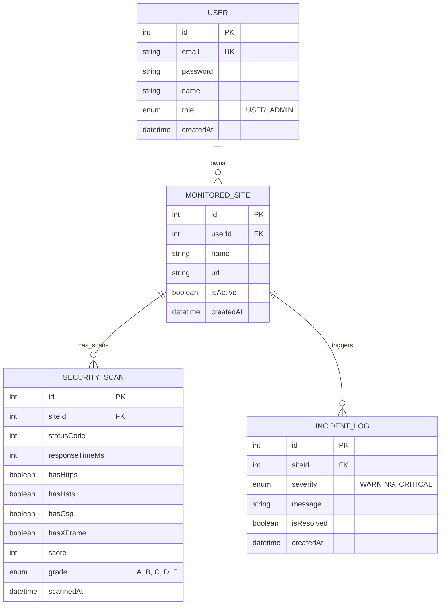

# Rendszerterv (Technikai Architektúra) – SecAudit

| Dokumentum tulajdonság | Érték |
| :--- | :--- |
| **Verzió** | 1.0.0 |
| **Készítette (Draft)** | AI-Planner (Gemini) |
| **Lektorálta és Jóváhagyta** | Lénárt Gábor – Vezető Fejlesztő (Lead-Dev & QA) |
| **Státusz** | Elfogadva / Aláírva |

---

## 1. Architektúra és Technológiai Stack
A rendszer háromrétegű, konténerizált mikro-architektúrára épül:
* **Frontend:** React 18 (Vite), React Router v6, Bootstrap 5, Axios. Port: `3000`.
* **Backend:** Node.js 20 LTS, Express.js, Prisma ORM, JSON Web Token (JWT), Bcrypt, Swagger UI (`/api-docs`), Jest (Unit tesztek). Port: `5000`.
* **Adatbázis:** MySQL 8.0 relációs adatbázis. Port: `3306`.
* **Infrastruktúra:** Docker & Docker Compose, élesítés Oracle Cloud Always Free Ubuntu LTS VPS-en.

---

## 2. Adatbázis Terv (Mermaid ER-Diagram)

---

## 3. REST API Végpontok Specifikációja

| Metódus | Útvonal | Védelem | Leírás |
| :--- | :--- | :--- | :--- |
| `POST` | `/api/auth/register` | Publikus | Új felhasználó regisztrációja. |
| `POST` | `/api/auth/login` | Publikus | Bejelentkezés, JWT token visszaadása. |
| `GET` | `/api/sites` | JWT (`USER`) | Bejelentkezett felhasználó saját weboldalainak listázása a legutóbbi scan eredménnyel. |
| `POST` | `/api/sites` | JWT (`USER`) | Új monitorozott weboldal felvétele (SSRF és URL validációval). |
| `DELETE` | `/api/sites/:id` | JWT (`USER`) | Saját monitorozott weboldal törlése. |
| `POST` | `/api/sites/:id/scan` | JWT (`USER`) | Azonnali biztonsági és uptime ellenőrzés futtatása az adott URL-re. |
| `GET` | `/api/sites/:id/history` | JWT (`USER`) | Egy adott weboldal összes korábbi mérésének és incidenseinek lekérése. |
| `PATCH` | `/api/incidents/:id/resolve` | JWT (`USER`) | Egy incidens „Megoldva” (`isResolved = true`) állapotba helyezése. |
| `GET` | `/api/admin/overview` | JWT (`ADMIN`) | Globális statisztikák és az összes rögzített weboldal listája. |
| `DELETE` | `/api/admin/sites/:id` | JWT (`ADMIN`) | Bármely weboldal adminisztrátori törlése (moderáció). |

---

## 4. A Biztonsági Pontozó Algoritmus (`securityScorer.js`)

A pontozó modul egy tiszta függvény (`calculateSecurityScore(scanInput)`), amely 100 pontról indul, és a hiányosságok alapján von le pontokat:
* **Nem elérhető oldal (`statusCode === 0` vagy `statusCode >= 500`):** Azonnali 0 pont, érdemjegy: `F`.
* **HTTPS hiánya (`!hasHttps`):** -40 pont.
* **Content-Security-Policy hiánya (`!hasCsp`):** -20 pont.
* **Strict-Transport-Security hiánya (`!hasHsts`):** -15 pont.
* **X-Frame-Options hiánya (`!hasXFrame`):** -15 pont.
* **Lassú válaszidő (`responseTimeMs > 1000`):** -10 pont.

**Osztályzatok (Grade) ponthatárai:**
* **90 – 100 pont:** `A`
* **75 – 89 pont:** `B`
* **60 – 74 pont:** `C`
* **40 – 59 pont:** `D`
* **0 – 39 pont:** `F`

---

## 5. Prompt és Emberi Validációs Napló (HITL)
* **AI-Planner (Gemini) eredeti tervezet:** Az adatmodell tervezetében a `SecurityScan` és `IncidentLog` tábláknál nem szerepelt a törlési viselkedés meghatározása.
* **Vezető Fejlesztő (Humán) korrekció:** A relációs integritás biztosítása érdekében tervezési előírásként rögzítve, hogy a #4-es feladatban készülő Prisma sémában minden idegen kulcshoz `onDelete: Cascade` szabályt kell alkalmazni, így egy weboldal törlésekor a hozzá tartozó mérések és incidensek is tisztán törlődnek.